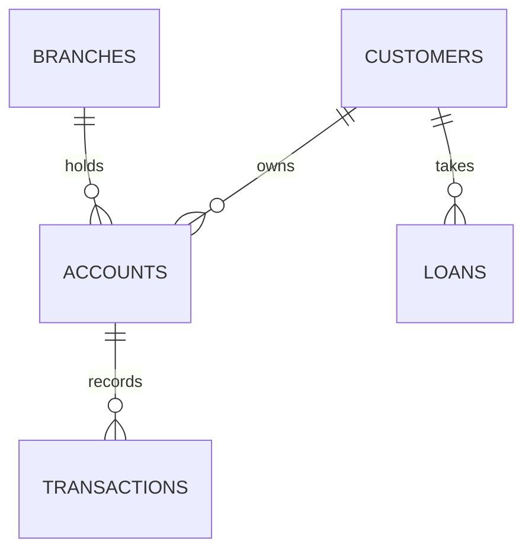

# 🏦 Banking Management Database

A MySQL project that designs a banking database from scratch and uses SQL to manage and analyze its data: customers, branches, accounts, transactions and loans.

**Tools:** MySQL Server · MySQL Workbench · Git & GitHub

---

## 📌 What This Project Covers

1. **Database design:** tables, keys and constraints
2. **Data operations:** inserting, updating and deleting records
3. **Data analysis:** filtering, sorting, functions and grouping
4. **Customer search and reporting:** pattern searches, built-in functions and aggregate summaries
5. **Loan risk and transaction reports:** window functions and joins
6. **Advanced analysis:** subqueries and views

---

## 🗂️ Database Structure

The `BankingDB` database has 5 tables:

| Table | Stores |
|---|---|
| `Customers` | Customer details such as name, email, phone and date of birth |
| `Branches` | Branch name, address and phone |
| `Accounts` | Account type and balance, linked to a customer and a branch |
| `Transactions` | Deposits and withdrawals, linked to an account |
| `Loans` | Loan amount, interest rate and dates, linked to a customer |

### Relationships

### Constraints Used

- **Primary keys** on every table
- **Foreign keys** connecting Accounts, Transactions and Loans to their parent tables
- **UNIQUE** on customer email
- **NOT NULL** on customer first name
- **CHECK** on accounts: balance must be at least 1000

The full EER diagram is available in [`EER.mwb`](EER.mwb) (open it with MySQL Workbench).

---

## 📁 Files

| File | Description |
|---|---|
| [Banking Database Design.sql](Banking%20Database%20Design.sql) | Creates the database, tables, keys and constraints |
| [Banking Operations and Data Analysis.sql](Banking%20Operations%20and%20Data%20Analysis.sql) | Inserts, updates and deletes data; SELECT queries, CASE statements and window functions |
| [Customer Search System.sql](Customer%20Search%20System.sql) | LIKE and IN searches, sorting, LIMIT/OFFSET, string, math and date functions, aggregates, GROUP BY and HAVING |
| [Loan Risk and Transaction Reports.sql](Loan%20Risk%20and%20Transaction%20Reports.sql) | Loan ranking with RANK, DENSE_RANK, ROW_NUMBER, LAG and LEAD; INNER JOIN and LEFT JOIN transaction reports |
| [Subqueries and SQL Views.sql](Subqueries%20and%20SQL%20Views.sql) | Subqueries for above-average and highest-balance analysis; a reusable view for high-balance accounts |
| [EER.mwb](EER.mwb) | EER diagram of the database |

---

## 🧠 SQL Concepts Demonstrated

| Area | Concepts |
|---|---|
| Structure | `CREATE`, `ALTER`, `DROP`, `PRIMARY KEY`, `FOREIGN KEY`, `UNIQUE`, `CHECK` |
| Data changes | `INSERT`, `UPDATE`, `DELETE` |
| Querying | `WHERE`, `AND` / `OR`, `IN`, `BETWEEN`, `LIKE`, `ORDER BY`, `DISTINCT`, `LIMIT`, `OFFSET`, `IS NULL` |
| Logic | `CASE`, `IF`, `IFNULL`, `NULLIF`, `GREATEST`, `LEAST` |
| Functions | String, math, and date and time functions |
| Summaries | `SUM`, `AVG`, `MIN`, `MAX`, `COUNT`, `GROUP BY`, `HAVING` |
| Window functions | `OVER`, `PARTITION BY`, `RANK`, `DENSE_RANK`, `ROW_NUMBER`, `LAG`, `LEAD`, running totals |
| Joins | `INNER JOIN`, `LEFT JOIN` |
| Advanced | Subqueries, Views |

---

## ▶️ How to Run

1. Open **MySQL Workbench** and connect to your MySQL server.
2. Run the files **in this order**:
   1. `Banking Database Design.sql`
   2. `Banking Operations and Data Analysis.sql`
   3. `Customer Search System.sql`
   4. `Loan Risk and Transaction Reports.sql`
   5. `Subqueries and SQL Views.sql`

> ⚠️ **Note:** Run the data operations file only once on a database. It inserts records with fixed IDs and deletes some rows, so running it again will cause duplicate-key errors. To start over, use a fresh database.

### Expected Record Counts

After the first two files, the tables contain:

| Table | Records |
|---|---:|
| Customers | 4 |
| Branches | 5 |
| Accounts | 3 |
| Transactions | 4 |
| Loans | 5 |

---

## 📝 Note

All names, contact details and amounts in this project are fictional sample data created for learning purposes. They do not represent real people or real accounts.

---

## 👩‍💻 Author

**Manvi Gupta**
GitHub: [@Manvi812](https://github.com/Manvi812)
